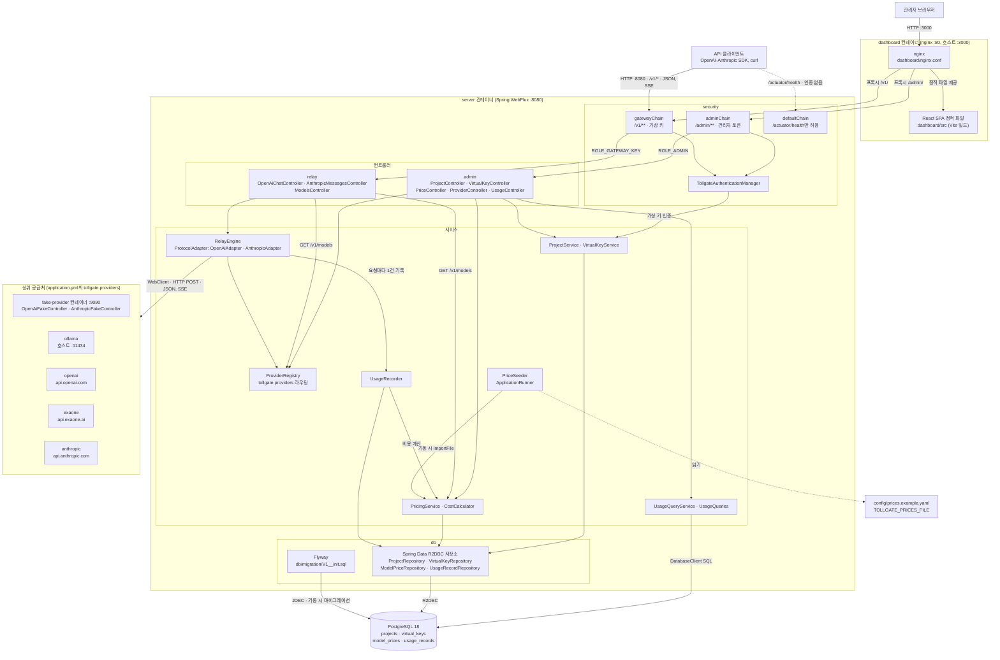
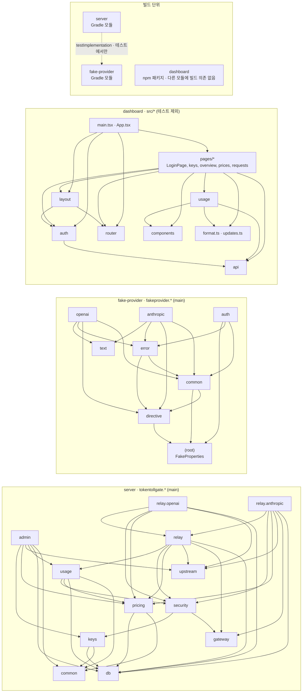
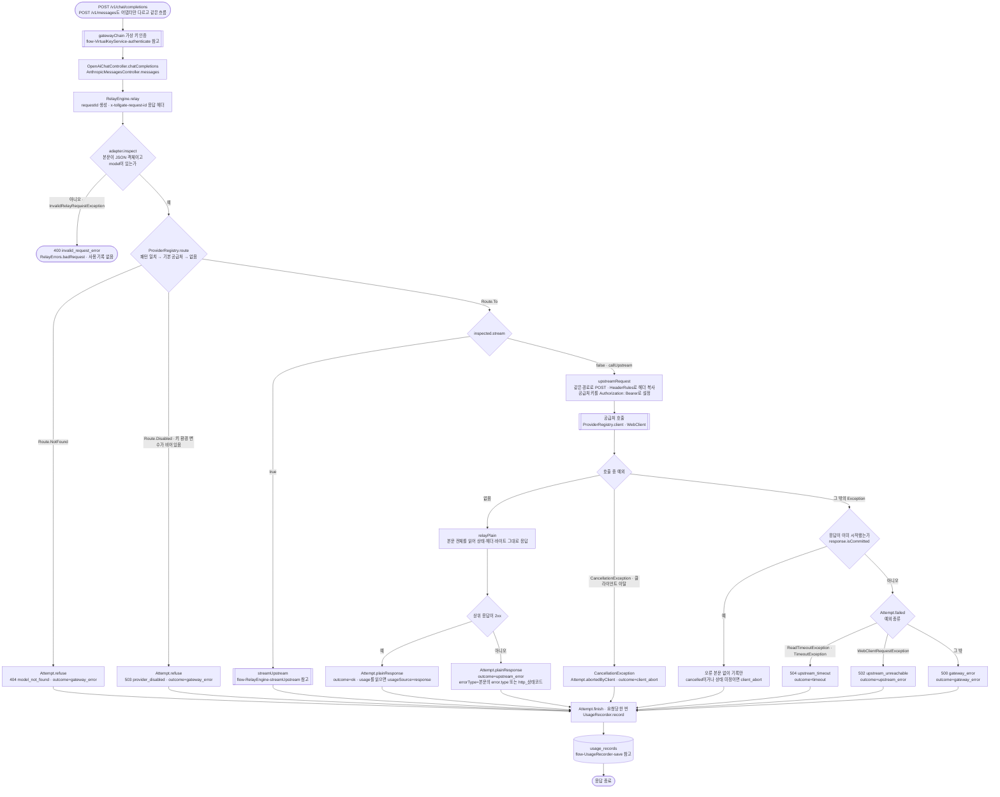
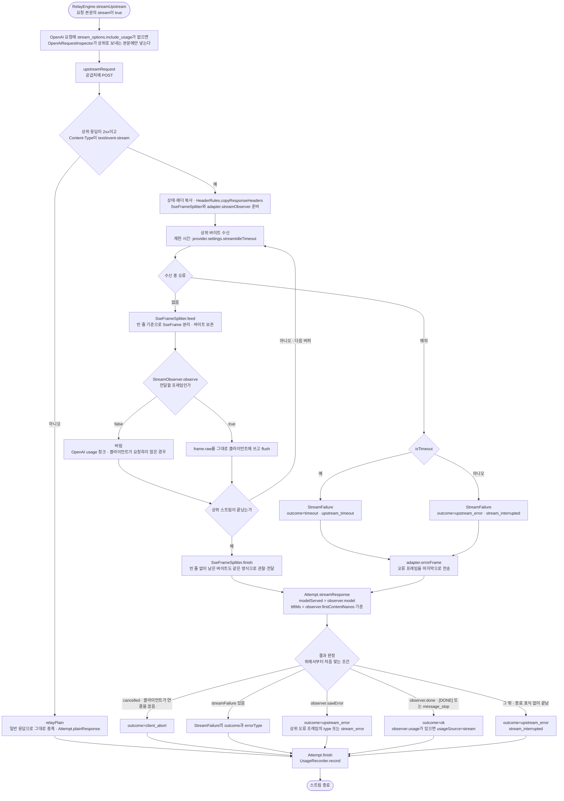
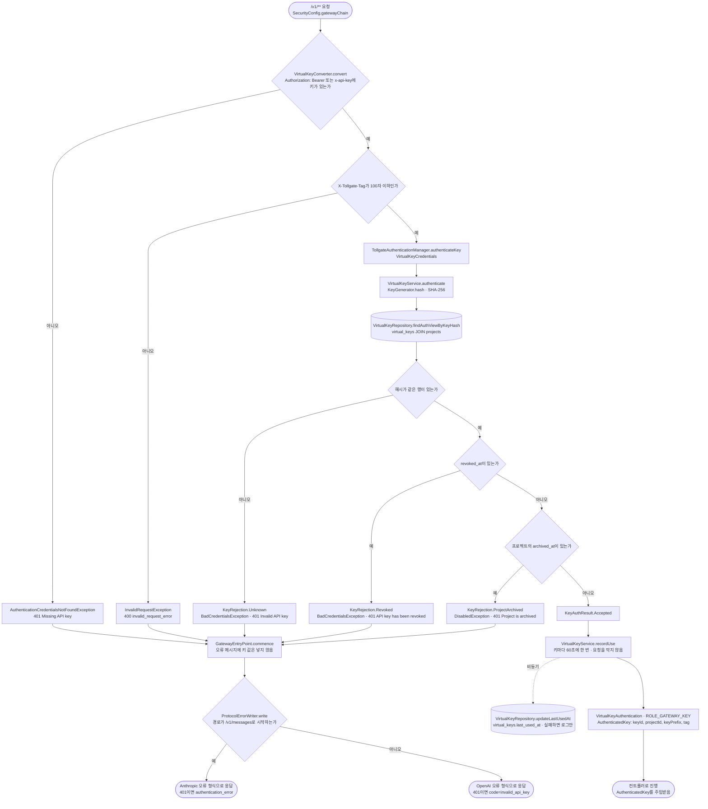
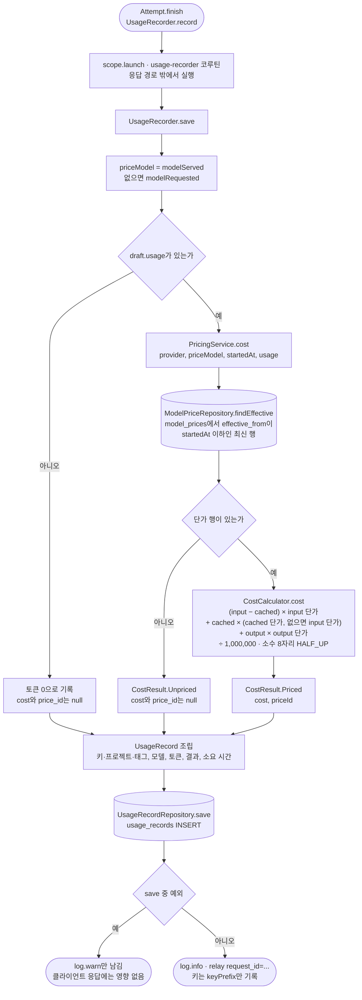
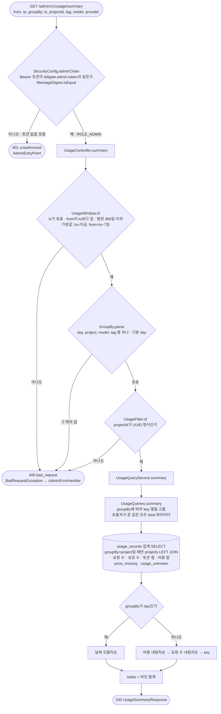
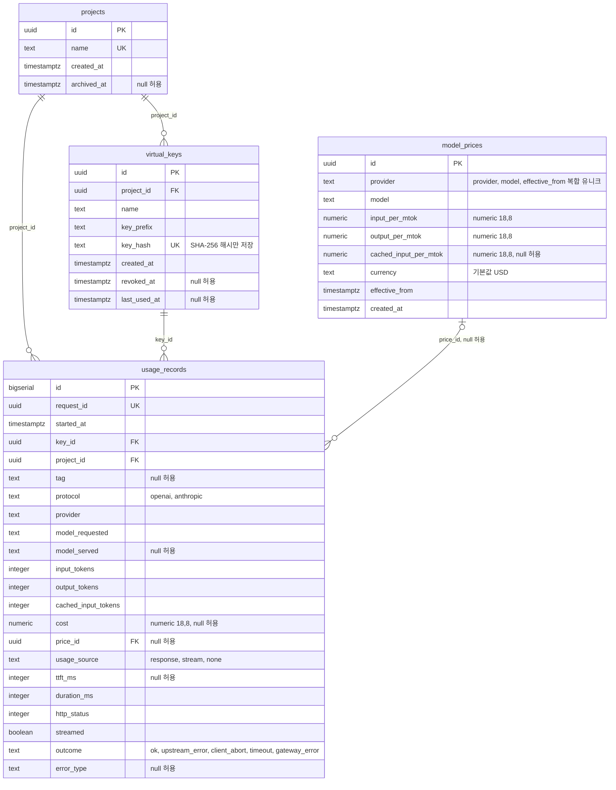

# 아키텍처 다이어그램

token-tollgate의 전체 구조, 모듈 의존성, 핵심 흐름 다섯 개, DB 엔티티 관계를 코드에서 읽어 그린 다이어그램 모음이다.

- 생성 일자: 2026-11-15
- 기준: `main` 브랜치, 커밋 `58bf398e32f4bbdf58c7e7854031f9e6463bd882`
- 생성 방법: codemap 플러그인 1.1.0의 명령 `/codemap:architecture`, `/codemap:deps`, `/codemap:flow`(대상 다섯 개), `/codemap:er`를 차례로 실행했다. 각 명령의 절차대로 코드를 분석해 Mermaid를 쓰고 `@mermaid-js/mermaid-cli` 12.2.0으로 SVG를 렌더링했다. 렌더링 명령에는 설치된 Chrome을 쓰는 옵션(`-p`) 하나만 더했다. 렌더링에 성공한 Mermaid만 실었고, 아래 코드 블록은 SVG를 만든 원본과 같다.
- 이 문서는 위 커밋의 코드를 기준으로 한다. 코드가 바뀌면 다이어그램도 다시 만들어야 한다.

## 목록

| # | 다이어그램 | SVG | 보여 주는 것 |
|---|---|---|---|
| 1 | 전체 시스템 구조 | [architecture.svg](architecture.svg) | 컨테이너 넷과 서버 안의 계층, 상위 공급처 호출 |
| 2 | 모듈 의존성 | [deps.svg](deps.svg) | 패키지·디렉터리 단위 import 관계, 순환 여부 |
| 3 | 중계 요청 흐름 | [flow-post-v1-chat-completions.svg](flow-post-v1-chat-completions.svg) | `POST /v1/chat/completions`가 들어와 기록될 때까지 |
| 4 | 스트리밍 중계 | [flow-RelayEngine-streamUpstream.svg](flow-RelayEngine-streamUpstream.svg) | SSE 프레임 전달과 실패 판정 |
| 5 | 가상 키 인증 | [flow-VirtualKeyService-authenticate.svg](flow-VirtualKeyService-authenticate.svg) | `/v1/**` 요청의 키 검사와 거부 응답 |
| 6 | 사용 기록과 비용 계산 | [flow-UsageRecorder-save.svg](flow-UsageRecorder-save.svg) | 단가 조회, 비용 계산, `usage_records` 저장 |
| 7 | 사용량 요약 조회 | [flow-get-admin-v1-usage-summary.svg](flow-get-admin-v1-usage-summary.svg) | `GET /admin/v1/usage/summary`의 검증과 집계 |
| 8 | DB 엔티티 관계 | [er.svg](er.svg) | 테이블 넷과 외래 키 |

다이어그램 안의 `flow-...` 표기는 이 폴더의 다른 흐름도를 가리킨다.

## 1. 전체 시스템 구조

`docker compose`로 뜨는 컨테이너 넷(dashboard, server, fake-provider, postgres)과 server 안의 계층(보안 체인 → 컨트롤러 → 서비스 → 저장소), 상위 공급처로 나가는 호출을 보여 준다. 화살표 라벨은 통신 방식이나 호출 목적이다.

- 근거: `docker-compose.yml`, `dashboard/nginx.conf`, `server/src/main/resources/application.yml`, `server/src/main/kotlin/tokentollgate/security/SecurityConfig.kt`, 각 컨트롤러와 서비스의 생성자 매개변수.
- 포트와 호스트 이름은 `docker-compose.yml`과 `application.yml`의 기본값이다. `.env`로 바꾸면 달라진다.
- "API 클라이언트"와 "관리자 브라우저"는 코드에 없는 외부 사용자다(추정). `/actuator/health`는 실제로는 `server/Dockerfile`의 HEALTHCHECK와 `scripts/smoke.sh`가 호출한다.

SVG: [architecture.svg](architecture.svg)

## 2. 모듈 의존성

소스의 import 문을 집계해 만든 의존성 그래프다. 화살표는 "출발 쪽이 도착 쪽을 import한다"는 뜻이다. server는 `tokentollgate.*` 패키지, fake-provider는 `fakeprovider.*` 패키지, dashboard는 `dashboard/src` 아래 디렉터리 단위이며 테스트 소스는 뺐다.

- **순환 의존성: 없음.** server와 fake-provider는 패키지 수준에서, dashboard는 파일 수준에서 순환이 없다.
- dashboard의 `src` 루트는 진입점(`main.tsx`, `App.tsx`)과 공용 함수(`format.ts`, `updates.ts`)로 나눠 그렸다. 루트를 한 덩어리로 보면 `App.tsx → pages → format.ts` 때문에 디렉터리 수준에서는 순환처럼 보이지만, 파일 사이에는 순환이 없다.
- `pages/*`는 `LoginPage.tsx`와 하위 디렉터리 넷(`keys`, `overview`, `prices`, `requests`)을 하나로 합친 것이다. 의존 대상이 거의 같아 합쳤다.
- server의 루트 패키지(`TokenTollgateApplication`)는 다른 패키지와 import 관계가 없어 그리지 않았다.
- 모듈 사이의 빌드 의존은 `server/build.gradle.kts`의 `testImplementation(project(":fake-provider"))` 하나다. dashboard는 서버와 HTTP로만 통신한다.
- 근거: `server/src/main/kotlin`, `fake-provider/src/main/kotlin`, `dashboard/src`의 import 문, `settings.gradle.kts`, `server/build.gradle.kts`.

SVG: [deps.svg](deps.svg)

## 3. 중계 요청 흐름: `POST /v1/chat/completions`

게이트웨이의 본 경로다. 요청 본문 검사, 공급처 라우팅, 상위 호출, 응답 중계, 실패 종류별 응답과 사용 기록까지를 보여 준다. `POST /v1/messages`도 어댑터(`AnthropicAdapter`)만 다르고 같은 `RelayEngine.relay`를 탄다.

- 어떤 경로로 끝나든 `Attempt.finish`가 요청당 한 번 사용 기록을 남긴다. 예외는 본문 검사에서 걸린 400으로, 이때는 기록하지 않는다.
- 근거: `relay/RelayEngine.kt`, `relay/RelayErrors.kt`, `relay/RelayJson.kt`, `relay/HeaderRules.kt`, `relay/openai/OpenAiChatController.kt`, `relay/anthropic/AnthropicMessagesController.kt`, `upstream/ProviderRegistry.kt` (모두 `server/src/main/kotlin/tokentollgate/` 아래).

SVG: [flow-post-v1-chat-completions.svg](flow-post-v1-chat-completions.svg)

## 4. 스트리밍 중계: `RelayEngine.streamUpstream`

`stream: true` 요청에서 상위 SSE 스트림을 프레임 단위로 나눠 그대로 전달하면서, 관찰자(`StreamObserver`)가 모델·사용량·첫 토큰 시각을 읽는 과정이다. 스트림이 끝난 뒤 결과(`outcome`)를 어떻게 판정하는지도 담았다.

- 프레임은 바이트를 바꾸지 않고 전달한다. 버리는 것은 클라이언트가 요청하지 않은 OpenAI usage 청크 하나뿐이다.
- 클라이언트가 연결을 끊은 경우 그림에서는 결과 판정의 첫 가지로 그렸다. 실제로는 `RelayEngine.relay`의 `CancellationException` 처리로 먼저 끝날 수도 있고, 어느 쪽이든 `client_abort`로 기록된다. 어느 경로를 타는지는 실행 시점에 따라 달라 코드만으로 확정하지 못했다(추정).
- 근거: `relay/RelayEngine.kt`, `relay/SseFrames.kt`, `relay/ProtocolAdapter.kt`, `relay/openai/OpenAiRequestInspector.kt`, `relay/openai/OpenAiStreamObserver.kt`, `relay/anthropic/AnthropicStreamObserver.kt`.

SVG: [flow-RelayEngine-streamUpstream.svg](flow-RelayEngine-streamUpstream.svg)

## 5. 가상 키 인증: `VirtualKeyService.authenticate`

`/v1/**` 요청이 컨트롤러에 닿기 전에 거치는 인증이다. 헤더에서 키를 읽고, SHA-256 해시로 조회하고, 폐기된 키와 보관된 프로젝트를 거부한다. 거부 응답은 요청 경로에 따라 OpenAI 형식이나 Anthropic 형식으로 나간다.

- 키는 평문으로 저장하지 않으므로 조회는 해시 비교 한 번이다. 오류 메시지에는 키 값이 들어가지 않는다.
- `last_used_at` 갱신은 요청을 막지 않는 별도 쓰기이고, 키마다 60초에 한 번만 한다.
- 근거: `security/SecurityConfig.kt`, `security/Converters.kt`, `security/AuthenticationManagers.kt`, `security/EntryPoints.kt`, `keys/VirtualKeyService.kt`, `keys/KeyGenerator.kt`, `gateway/ProtocolErrorWriter.kt`, `db/Repositories.kt`.

SVG: [flow-VirtualKeyService-authenticate.svg](flow-VirtualKeyService-authenticate.svg)

## 6. 사용 기록과 비용 계산: `UsageRecorder.save`

요청이 끝난 뒤 `usage_records`에 한 행을 쓰는 과정이다. 요청 시각에 유효한 단가를 찾아 비용을 계산하고, 단가가 없거나 사용량을 읽지 못한 경우에는 비용 없이 기록한다.

- 저장은 응답 경로 밖의 코루틴에서 실행된다. 실패해도 로그만 남고 클라이언트 응답은 바뀌지 않는다.
- 비용 식은 `CostCalculator`의 주석과 구현을 그대로 옮겼다. 단가는 토큰 백만 개당 금액이다.
- 근거: `usage/UsageRecorder.kt`, `pricing/PricingService.kt`, `pricing/CostCalculator.kt`, `db/Repositories.kt`, `db/Entities.kt`.

SVG: [flow-UsageRecorder-save.svg](flow-UsageRecorder-save.svg)

## 7. 사용량 요약 조회: `GET /admin/v1/usage/summary`

대시보드의 개요 화면이 부르는 조회다. 관리자 토큰 확인, 기간·그룹·필터 검증, 집계 SQL, 정렬과 합계까지를 보여 준다.

- 호출자가 준 값은 시간대 이름까지 모두 bind 파라미터로 전달된다. SQL 문자열은 고정된 조각으로만 조립된다.
- 일별 묶음은 `tz`로 받은 시간대 기준이고, 저장된 시각은 UTC다.
- 근거: `admin/UsageController.kt`, `admin/AdminErrorHandler.kt`, `usage/UsageQuery.kt`, `usage/UsageQueryService.kt`, `usage/UsageQueries.kt`, `security/SecurityConfig.kt`, `security/AuthenticationManagers.kt`.

SVG: [flow-get-admin-v1-usage-summary.svg](flow-get-admin-v1-usage-summary.svg)

## 8. DB 엔티티 관계

테이블 넷과 그 사이의 외래 키다. 프로젝트가 가상 키를 여러 개 갖고, 사용 기록은 키·프로젝트·(있으면) 적용된 단가 행을 가리킨다.

- **이 그림은 코드 기준이다.** 마이그레이션(`V1__init.sql`)과 엔티티(`Entities.kt`), 저장소(`Repositories.kt`)를 읽어 그렸고, 실제 DB에 접속해 확인하지 않았다. 운영 중인 DB의 스키마는 이와 다를 수 있다.
- Flyway가 만드는 이력 테이블(`flyway_schema_history`)과 인덱스 셋(`virtual_keys_project_id_idx`, `usage_records_project_started_idx`, `usage_records_started_idx`)은 그림에 넣지 않았다.
- `model_prices`의 유니크 제약은 `(provider, model, effective_from)` 복합이다. `protocol`, `usage_source`, `outcome`은 CHECK 제약으로 값이 고정된 text 열이고, 코드에서는 `db/Enums.kt`의 enum과 대응한다.
- 근거: `server/src/main/resources/db/migration/V1__init.sql`, `server/src/main/kotlin/tokentollgate/db/Entities.kt`, `db/Repositories.kt`, `db/Enums.kt`.

SVG: [er.svg](er.svg)

## 검증

다이어그램에 쓴 이름이 실제 코드에 있는지 기계적으로 대조했다.

- 방법: Mermaid 원본의 라벨에서 코드처럼 보이는 토큰(클래스, 메서드, 파일 경로, 테이블·열, URL 경로, 오류 코드)을 뽑아, 저장소의 추적 파일 중 `docs/` 밖에서 찾았다.
- 결과: 토큰 360개 중 199개는 선언(클래스·함수·속성, 스키마의 테이블·열, 존재하는 파일)으로 확인했고, 146개는 선언은 아니지만 코드나 설정에 쓰이는 이름이다(`WebClient`, `DatabaseClient`, `BadCredentialsException` 같은 프레임워크 타입, 설정 키, 문자열 리터럴, 일반 단어).
- 나머지 15개는 코드에 그 표기 그대로는 없다. 모두 코드 요소가 아닌 표기였다: ER 표기(`PK`, `FK`, `UK`)와 `2xx`, 설정에는 소문자로만 나오는 기술 이름(`Flyway`, `R2DBC`, `JDBC`, `Spring Data`), 설명용 단어(`SDK`, `SPA`), 한글 조사가 붙어 잘린 경로 셋(경로 자체는 코드에 있다), 디렉터리 묶음 표기 `pages/*`, MIME 문자열 `text/event-stream`(코드에서는 `MediaType.TEXT_EVENT_STREAM`).
- 존재하지 않는 클래스, 파일, 테이블을 가리키는 이름은 없었다.

이 대조는 이름의 존재만 확인한다. 화살표(관계)는 의존성 그림은 import 집계로, 나머지는 해당 코드를 읽어 그렸다.

### 추정으로 표시한 것

| 다이어그램 | 요소 | 이유 |
|---|---|---|
| 전체 시스템 구조 | "API 클라이언트", "관리자 브라우저" | 코드에 없는 외부 사용자다. `examples/requests.http`와 대시보드의 존재로 미루어 그렸다. |
| 전체 시스템 구조 | API 클라이언트 → `defaultChain` 화살표 | `/actuator/health`의 호출자는 서버 코드에 없다. 저장소에서 확인한 호출자는 Dockerfile의 HEALTHCHECK와 `scripts/smoke.sh`다. |
| 스트리밍 중계 | 클라이언트 연결 끊김이 결과 판정으로 가는 경로 | `client_abort`로 기록되는 것은 코드로 확인했지만, 두 처리 경로 중 어느 쪽을 타는지는 실행 시점에 달려 있다. |

## 한계

- 흐름도는 주요 분기만 담았다. 로그, 헤더 복사 규칙의 세부, 타임아웃 값은 코드와 설정을 봐야 한다.
- 의존성 그림은 import 문 기준이다. 같은 패키지 안의 참조와 Spring의 컴포넌트 스캔처럼 import 없이 이어지는 관계는 나타나지 않는다.
- SVG는 글꼴을 내장해 파일당 250~410KB이고 배경이 투명하다. 어두운 테마에서는 선과 바깥 글자가 잘 보이지 않을 수 있으니 그럴 때는 위의 Mermaid 블록을 본다.
